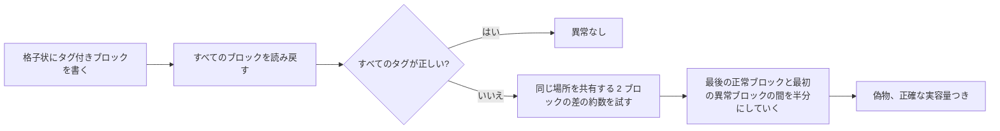
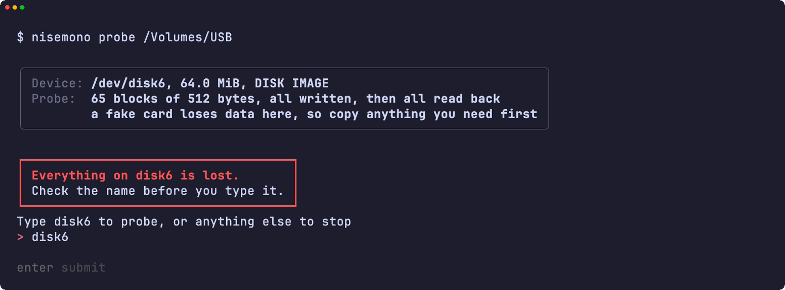
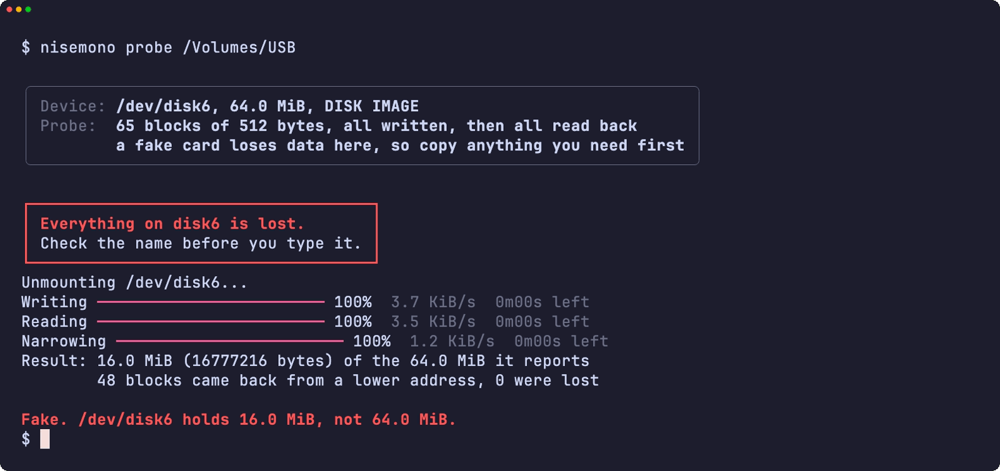
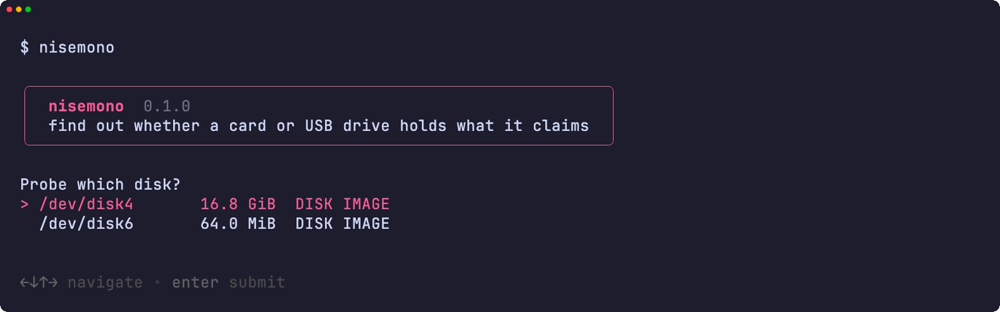
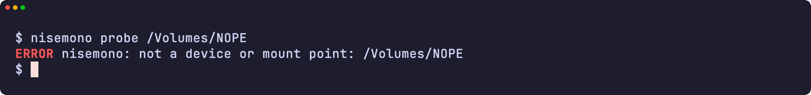
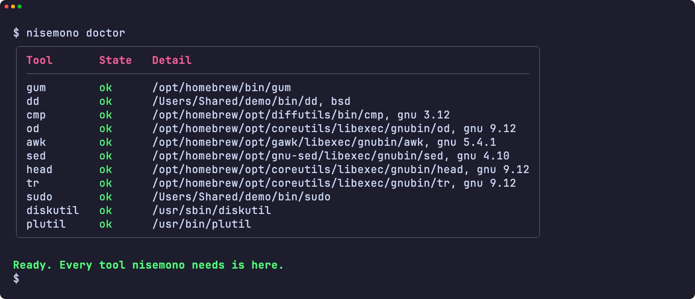
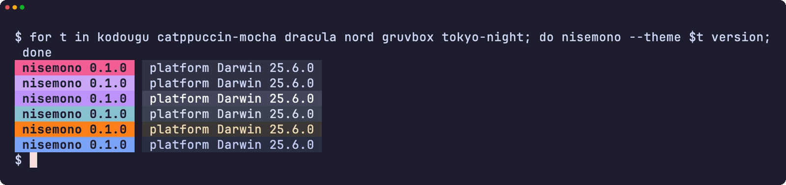
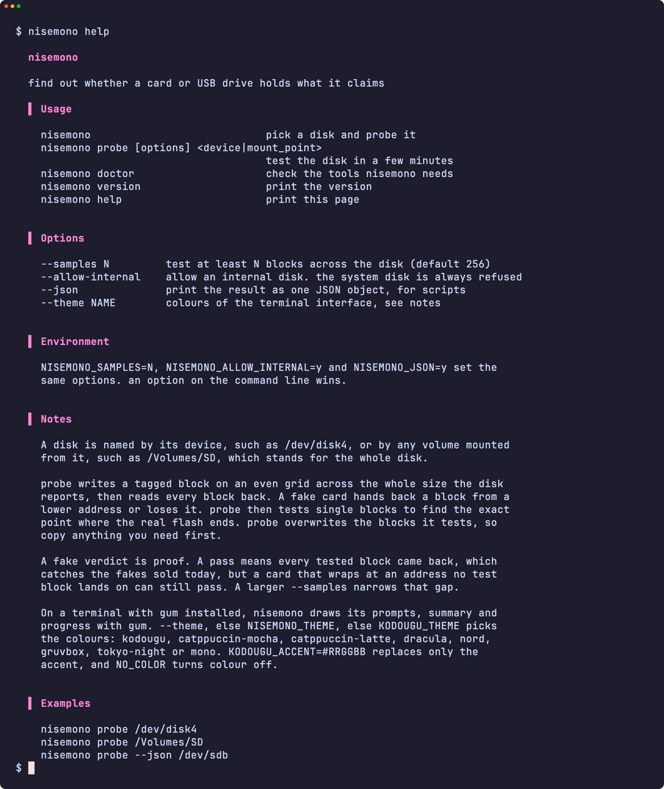
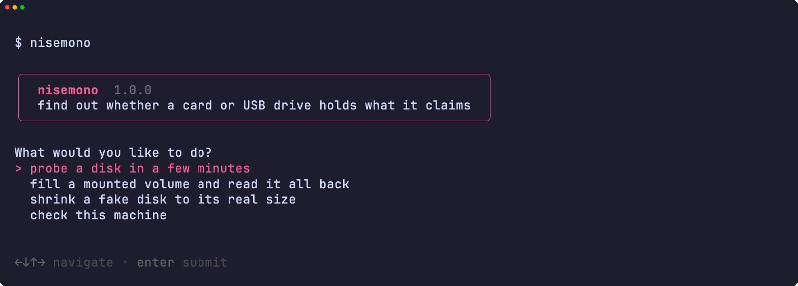

<div align="center">

<h1>nisemono</h1>

<strong>SD カードや USB ドライブが表示どおりの容量を持っているか、実際にどれだけ記録できるかを調べます。</strong>

[English](README.md) | 日本語 | [简体中文](README.zh-Hans.md) | [繁體中文 (香港)](README.zh-HK.md)

[](https://github.com/gufranco/nisemono/actions/workflows/ci.yml)
[](https://github.com/gufranco/nisemono/releases/latest)
[](LICENSE)

<p align="center">
  <a href="#quick-start"><strong>クイックスタート</strong></a> |
  <a href="#how-it-works">仕組み</a> |
  <a href="#development">開発</a>
</p>

</div>

偽物のカードは、実際のフラッシュより大きな容量を報告します。実際の容量を超えて書き込んだファイルは、前のデータの上に重なるか消えてしまい、開くまで誰も気づきません。`nisemono` は日本語の「偽物」です。同じファミリーの [kiyome](https://github.com/gufranco/kiyome) はディスクを消去し、[kakikomi](https://github.com/gufranco/kakikomi) はディスクイメージを書き込みます。

---

<p align="center">
  
</p>

```console
$ nisemono probe /dev/disk6

Device: /dev/disk6, 32.0 MiB, DISK IMAGE
Probe:  33 blocks of 512 bytes, all written, then all read back
        a fake card loses data here, so copy anything you need first

Type disk6 to probe, or anything else to stop: disk6
Unmounting /dev/disk6...
Writing 100%  7.8 KiB/s  0m00s left
Reading 100%  9.4 KiB/s  0m00s left
Narrowing 100%  2.3 KiB/s  0m00s left
Result: 9.5 MiB (9961472 bytes) of the 32.0 MiB it reports
        13 blocks came back from a lower address, 0 were lost
Fake. /dev/disk6 holds 9.5 MiB, not 32.0 MiB.
```

<a id="quick-start"></a>

## クイックスタート

### 前提条件

| ツール | 用途 | インストール |
|:-----|:----|:--------|
| [`gum`](https://github.com/charmbracelet/gum) | 端末インターフェース: プロンプト、表、色 | `brew install gum`。Homebrew の formula が自動で入れます |
| POSIX `sh`、`dd`、`cmp`、`od`、`head`、`tr` | ツール本体 | macOS と Linux に標準で入っています。`bash` は不要です |
| `diskutil` と `plutil`、または `lsblk` と `blockdev` | macOS または Linux でのディスク情報 | 標準で入っています |
| mtools の `mformat` | `fix` が新しい FAT ファイルシステムを作るときだけ | `brew install mtools` または `apt install mtools`。Homebrew の formula が自動で入れます |

### インストール

```bash
brew install gufranco/tap/nisemono
```

ソースから入れる場合:

```bash
git clone https://github.com/gufranco/nisemono.git
cd nisemono
make install
```

`make install` はツール、man ページ、bash・zsh・fish の補完を `~/.local` の下にコピーし、`nisemono` を `~/.local/bin` に置きます。場所は `PREFIX` で変えられます。

### 確認

```console
$ nisemono doctor
gum                ok       /opt/homebrew/bin/gum
dd                 ok       /opt/homebrew/opt/coreutils/libexec/gnubin/dd, gnu 9.12
cmp                ok       /opt/homebrew/opt/diffutils/bin/cmp, gnu 3.12
od                 ok       /opt/homebrew/opt/coreutils/libexec/gnubin/od, gnu 9.12
awk                ok       /opt/homebrew/opt/gawk/libexec/gnubin/awk, gnu 5.4.1
sed                ok       /opt/homebrew/opt/gnu-sed/libexec/gnubin/sed, gnu 4.10
head               ok       /opt/homebrew/opt/coreutils/libexec/gnubin/head, gnu 9.12
tr                 ok       /opt/homebrew/opt/coreutils/libexec/gnubin/tr, gnu 9.12
sudo               ok       /usr/bin/sudo
diskutil           ok       /usr/sbin/diskutil
plutil             ok       /usr/bin/plutil
mformat            ok       /opt/homebrew/bin/mformat
```

## 使い方

| コマンド | 目的 |
|:--------|:--------|
| `nisemono probe [options] <device\|mount_point>` | 数分でディスクを調べ、実際の容量を報告します |
| `nisemono fill <mount_point>` | ボリュームの空き領域を確認用ファイルで埋め、全バイトを読み戻してから削除します。時間はかかりますが、あなたのファイルには触れません |
| `nisemono fix <device\|mount_point>` | ディスクを調べ、偽物なら実際の容量の内側に FAT パーティションを 1 つ作ります。中身はすべて消えます |
| 引数なしの `nisemono` | 端末で実行すると、メニューから作業を選べます |
| 引数なしの `nisemono` | 端末で実行すると、ディスクを選んで調べます |
| `nisemono doctor` | 必要なツールと、それが入っているかを一覧にします |
| `nisemono version`、`nisemono help` | バージョンまたは使い方の全文を表示します |

| オプション | 効果 |
|:-------|:-------|
| `--samples N` | ディスク全体で少なくとも N ブロックを調べます。既定は 256 |
| `--allow-internal` | 内蔵ディスクを許可します。稼働中のシステムを含むディスクは常に拒否します |
| `--json` | 結果をスクリプト向けに 1 つの JSON オブジェクトで出力します |
| `--theme <name>` | 端末インターフェースの配色 |

`--samples=1024` の形も使え、`--` でオプションが終わります。`NISEMONO_SAMPLES=N`、`NISEMONO_ALLOW_INTERNAL=y`、`NISEMONO_JSON=y` で同じ設定ができ、コマンドラインのオプションが優先されます。

```bash
nisemono probe /dev/disk4                  # disk4 のカードを調べる
nisemono probe /Volumes/SD                 # マウント中のボリュームはディスク全体を指す
nisemono probe --samples 4096 /dev/sdb     # 細かい格子、時間がかかる
nisemono probe --json /dev/disk4           # スクリプト向けの JSON
nisemono fill /Volumes/SD                  # 空き領域を全バイト確かめ、ファイルは残す
nisemono fix /dev/disk4                    # 偽物のカードを実際の容量に合わせる
```

調べるブロックは上書きされ、偽物のカードではそれ以上のデータも上書きされます。必要なデータは先にカードからコピーしてください。nisemono はファミリー共通のコマンドライン規約に従います。規約は [FAMILY.md](FAMILY.md) にあります。

### テーマ

`gum` がある端末では、プロンプト、表、メッセージを gum で描きます。パイプやスクリプトでは出力はプレーンテキストのままです。配色は `--theme`、なければ `NISEMONO_THEME`、なければ `KODOUGU_THEME` で選びます: `kodougu` (既定)、`catppuccin-mocha`、`catppuccin-latte`、`dracula`、`nord`、`gruvbox`、`tokyo-night`、`mono`。`KODOUGU_ACCENT=#RRGGBB` はアクセント色だけを置き換え、`NO_COLOR` は色を消します。

<a id="how-it-works"></a>

## 仕組み

偽物のコントローラーは、フラッシュにないアドレスにも応答します。実際のフラッシュを超えた書き込みは、上位のアドレスビットが無視されるために前のアドレスに重なるか、捨てられます。



1. 各テストブロックには、この実行の乱数コードと自分のアドレスを持つタグがあります。読み込みの前にすべてを書き込みます。書いた直後に読むと必ず正しく見え、上書きは後のブロックが同じ場所に書かれたときにしか現れないからです。
2. 同じタグを読み戻したブロックは、フラッシュの同じ場所を共有しています。その中で最も低いアドレスが本物で、残りは実際のフラッシュの外にあります。正しいタグがないブロックは失われています。
3. 偽物と判定したあと、nisemono は同じ場所を共有する 2 ブロックの距離の約数から折り返しの大きさを探し、最後の正常ブロックと最初の異常ブロックの間を 1 ブロックになるまで半分にしていきます。

偽物という判定は証拠です。合格はすべてのテストブロックが戻ったことを意味し、今売られている偽物は見つけられますが、テストブロックが当たらないアドレスで折り返すカードは合格する可能性があります。`--samples` を大きくするとその隙間は狭まります。

稼働中のシステムを含むディスクは常に拒否し、内蔵ディスクは `--allow-internal` がない限り拒否します。書き込み保護されたカードはそのことを伝え、マウント中のボリュームは書き込む前にアンマウントします。

<a id="portability"></a>

## 移植性

すべて POSIX `sh` で書かれ、ShellCheck `-o all` の指摘はゼロです。テストは macOS の `/bin/sh`、`dash`、システムの bash 3.2 と zsh、Homebrew の最新 bash と zsh、そして Ubuntu の特権コンテナ内の `dash`、`bash`、`bash --posix`、`zsh` で動きます。[FAMILY.md](FAMILY.md) にある 6 つのツールセットすべてで動作し、`nisemono doctor` は各コアツールの種類とバージョンを表示します。

<a id="screens"></a>

## 画面

<details>
<summary><code>make screens</code> で実際の実行から記録したすべての画面</summary>
<br>

<table>
<tr>
<td width="50%" valign="top"><br><sub>危険を示す枠の下で入力する名前</sub></td>
<td width="50%" valign="top"><br><sub>偽物のディスクへの判定</sub></td>
</tr>
<tr>
<td width="50%" valign="top"><br><sub>ディスクの選択</sub></td>
<td width="50%" valign="top"><br><sub>エラー</sub></td>
</tr>
<tr>
<td width="50%" valign="top"><br><sub>doctor が必要なツールをすべて確認する</sub></td>
<td width="50%" valign="top"><br><sub>6 つのテーマのバージョン表示</sub></td>
</tr>
<tr>
<td width="50%" valign="top"><br><sub>ヘルプ</sub></td>
<td width="50%" valign="top"><br><sub>引数なしの nisemono が開くメニュー</sub></td>
</tr>
</table>

</details>

<a id="development"></a>

## 開発

| コマンド | 説明 |
|:--------|:------------|
| `make fmt` | すべてのスクリプトを shfmt で整形します |
| `make lint` | shfmt、全スクリプト・テスト・補完への ShellCheck、man ページへの mandoc |
| `make test` | システムの `sh` で `bats` テストを実行します |
| `make test-all` | 同じテストをすべてのシェルで実行します |
| `make test-linux` | 同じテストを Ubuntu コンテナで実行します |
| `make coverage` | この Mac と Ubuntu コンテナでの bashcov 行カバレッジを統合し、CI と同じ 100% の基準を確かめます |
| `make screens` | 実際のツールから VHS で README の画面を記録します (macOS) |

テストは `hdiutil` または `losetup` でファイルを元にしたディスクを接続し、実際に調べます。偽物のカードは、Linux ではディスクの一部を繰り返すか捨てる device-mapper のテーブルで、macOS では同じオフセットを付け替えるか捨てる `dd` の代役で再現します。

## ライセンス

[MIT](LICENSE)
