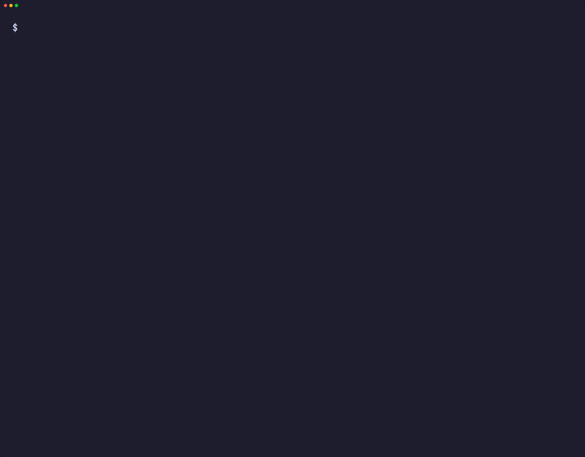
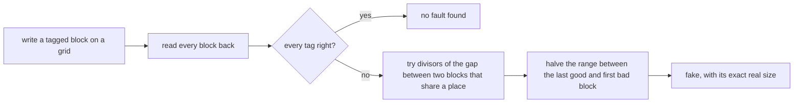
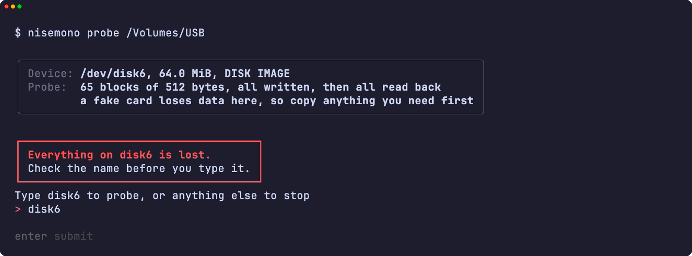
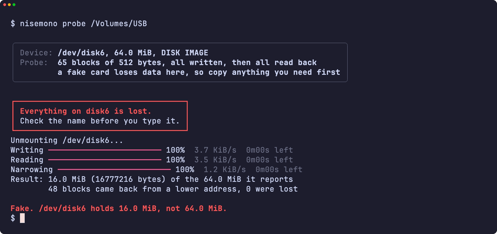
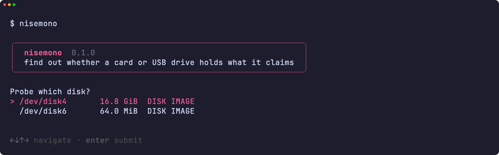
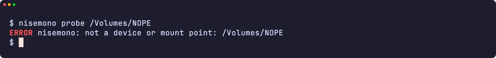
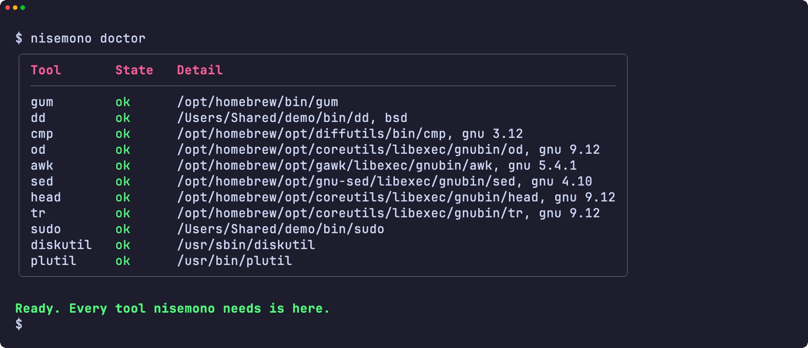
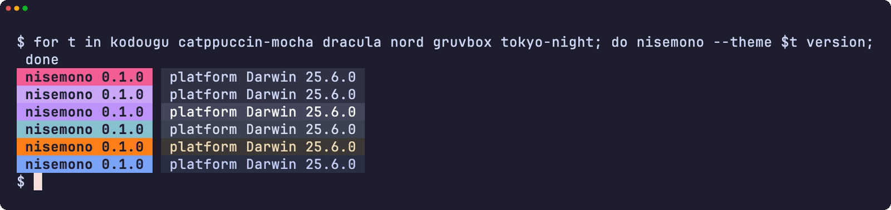
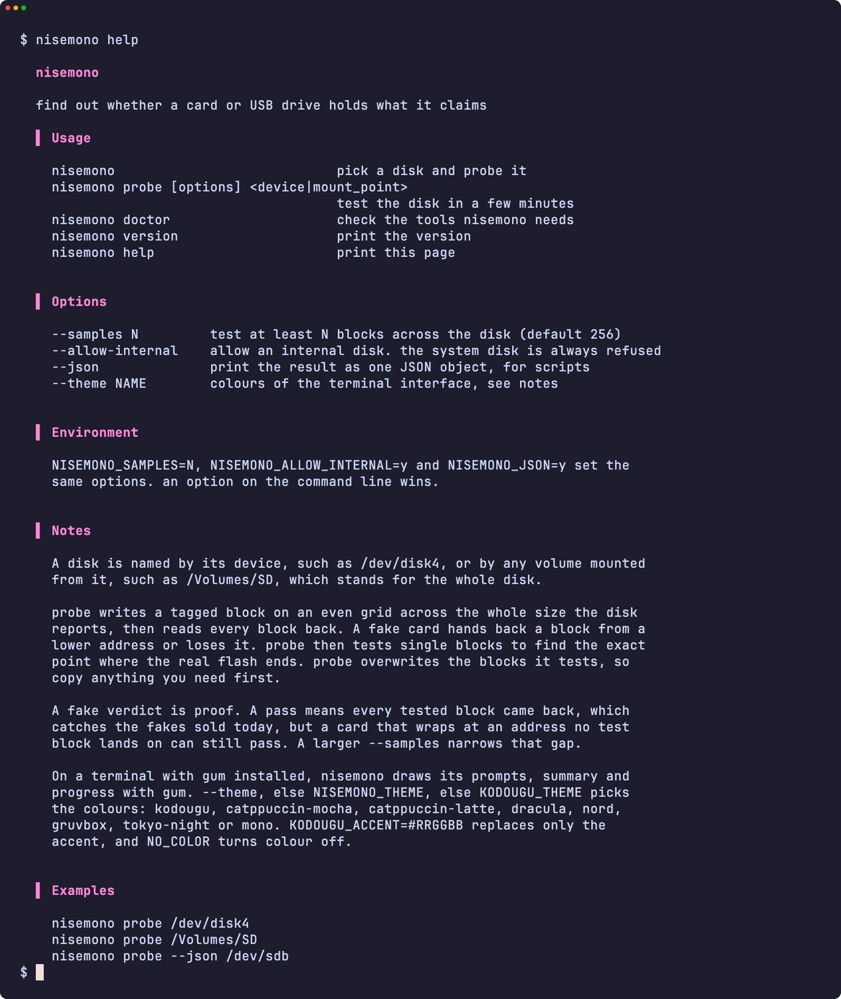

<div align="center">

<h1>nisemono</h1>

<strong>Find out whether an SD card or USB drive holds what it claims, and how much it really holds.</strong>

English | [日本語](README.ja.md) | [简体中文](README.zh-Hans.md) | [繁體中文 (香港)](README.zh-HK.md)

[](https://github.com/gufranco/nisemono/actions/workflows/ci.yml)
[](https://github.com/gufranco/nisemono/releases/latest)
[](LICENSE)

<p align="center">
  <a href="#quick-start"><strong>Quick start</strong></a> |
  <a href="#how-it-works">How it works</a> |
  <a href="#development">Development</a>
</p>

</div>

A counterfeit card reports more space than its flash holds. Files copied past the real flash land on top of earlier ones or vanish, and nothing complains until you open them. `nisemono`, 偽物, is Japanese for a fake. Its companions [kiyome](https://github.com/gufranco/kiyome) wipes disks and [kakikomi](https://github.com/gufranco/kakikomi) writes disk images.

---

<p align="center">
  
</p>

```console
$ nisemono probe /dev/disk6

Device: /dev/disk6, 32.0 MiB, DISK IMAGE
Probe:  33 blocks of 512 bytes, all written, then all read back
        a fake card loses data here, so copy anything you need first

Type disk6 to probe, or anything else to stop: disk6
Unmounting /dev/disk6...
Writing 100%  7.8 KiB/s  0m00s left
Reading 100%  9.4 KiB/s  0m00s left
Narrowing 100%  2.3 KiB/s  0m00s left
Result: 9.5 MiB (9961472 bytes) of the 32.0 MiB it reports
        13 blocks came back from a lower address, 0 were lost
Fake. /dev/disk6 holds 9.5 MiB, not 32.0 MiB.
```

<a id="quick-start"></a>

## Quick start

### Prerequisites

| Tool | Why | Install |
|:-----|:----|:--------|
| [`gum`](https://github.com/charmbracelet/gum) | The terminal interface: prompts, tables and colours | `brew install gum`. Installed automatically by the Homebrew formula |
| POSIX `sh`, `dd`, `cmp`, `od`, `head`, `tr` | The tool itself | Preinstalled on macOS and Linux. `bash` is not required |
| `diskutil` and `plutil`, or `lsblk` and `blockdev` | Disk details on macOS, or on Linux | Preinstalled |

### Install

```bash
brew install gufranco/tap/nisemono
```

Or from source:

```bash
git clone https://github.com/gufranco/nisemono.git
cd nisemono
make install
```

`make install` copies the tool, its man page and its bash, zsh and fish completions under `~/.local`, and puts `nisemono` in `~/.local/bin`; set `PREFIX` to change that.

### Verify

```console
$ nisemono doctor
gum                ok       /opt/homebrew/bin/gum
dd                 ok       /opt/homebrew/opt/coreutils/libexec/gnubin/dd, gnu 9.12
cmp                ok       /opt/homebrew/opt/diffutils/bin/cmp, gnu 3.12
od                 ok       /opt/homebrew/opt/coreutils/libexec/gnubin/od, gnu 9.12
awk                ok       /opt/homebrew/opt/gawk/libexec/gnubin/awk, gnu 5.4.1
sed                ok       /opt/homebrew/opt/gnu-sed/libexec/gnubin/sed, gnu 4.10
head               ok       /opt/homebrew/opt/coreutils/libexec/gnubin/head, gnu 9.12
tr                 ok       /opt/homebrew/opt/coreutils/libexec/gnubin/tr, gnu 9.12
sudo               ok       /usr/bin/sudo
diskutil           ok       /usr/sbin/diskutil
plutil             ok       /usr/bin/plutil
```

## Usage

| Command | Purpose |
|:--------|:--------|
| `nisemono probe [options] <device\|mount_point>` | Test the disk in a few minutes and report its real size |
| `nisemono` with no arguments | Pick a disk and probe it, when run in a terminal |
| `nisemono doctor` | List the tools nisemono needs and whether they are installed |
| `nisemono version`, `nisemono help` | Print the version or the full usage page |

| Option | Effect |
|:-------|:-------|
| `--samples N` | Test at least N blocks across the disk. 256 by default |
| `--allow-internal` | Allow an internal disk. The disk holding the running system is always refused |
| `--json` | Print the result as one JSON object, for scripts |
| `--theme <name>` | Colours of the terminal interface |

`--samples=1024` works too, and `--` ends the options. `NISEMONO_SAMPLES=N`, `NISEMONO_ALLOW_INTERNAL=y` and `NISEMONO_JSON=y` set the same options; an option on the command line wins.

```bash
nisemono probe /dev/disk4                  # test the card in disk4
nisemono probe /Volumes/SD                 # a mounted volume stands for its whole disk
nisemono probe --samples 4096 /dev/sdb     # a finer grid, slower
nisemono probe --json /dev/disk4           # one JSON object, for scripts
```

The probe overwrites the blocks it tests, and on a fake card it overwrites more, so copy anything you need off the card first. nisemono follows the shared command-line contract of its family, described in [FAMILY.md](FAMILY.md).

### Themes

On a terminal with `gum` installed, nisemono draws its prompts, tables and messages with gum; in a pipe or a script the output stays plain text. `--theme`, else `NISEMONO_THEME`, else `KODOUGU_THEME` picks the colours: `kodougu` (default), `catppuccin-mocha`, `catppuccin-latte`, `dracula`, `nord`, `gruvbox`, `tokyo-night` or `mono`. `KODOUGU_ACCENT=#RRGGBB` replaces only the accent, and `NO_COLOR` turns colour off.

<a id="how-it-works"></a>

## How it works

A fake controller answers for addresses its flash does not have. Past the real flash, a write either lands on an earlier address, because the controller ignores the high address bits, or is thrown away.



1. Every test block carries a tag with this run's random code and its own address. All of them are written before any is read, because a block read right after its write always looks fine; the overwrite only shows once a later block lands on it.
2. Blocks that read back the same tag share one place in the flash. The lowest of them is real and the rest lie past the real flash. A block with no valid tag was lost.
3. After a fake verdict, nisemono finds the wrap size among the divisors of the distance between two blocks that share a place, then halves the range between the last good and the first bad block until it reaches a single block.

A fake verdict is proof. A pass means every test block came back, which catches the fakes sold today, but a card that wraps at an address no test block lands on can still pass. A larger `--samples` narrows that gap.

The disk holding the running system is always refused, internal disks are refused unless `--allow-internal` is given, a write-protected card is named as such, and a mounted volume is unmounted before anything is written.

<a id="portability"></a>

## Portability

Everything is POSIX `sh` with ShellCheck `-o all` at zero findings. The suites run on macOS under `/bin/sh`, `dash`, the system's bash 3.2 and zsh, and Homebrew's current bash and zsh, and on Ubuntu under `dash`, `bash`, `bash --posix` and `zsh` in a privileged container. Every run works on the six toolsets in [FAMILY.md](FAMILY.md), and `nisemono doctor` names the flavor and version of every core tool.

<a id="screens"></a>

## Screens

<details>
<summary>Every screen, recorded from a real run with <code>make screens</code></summary>
<br>

<table>
<tr>
<td width="50%" valign="top"><br><sub>The typed name, under the danger box</sub></td>
<td width="50%" valign="top"><br><sub>The verdict on a fake disk</sub></td>
</tr>
<tr>
<td width="50%" valign="top"><br><sub>The disk picker</sub></td>
<td width="50%" valign="top"><br><sub>An error</sub></td>
</tr>
<tr>
<td width="50%" valign="top"><br><sub>doctor checks every tool it needs</sub></td>
<td width="50%" valign="top"><br><sub>The version badge in six themes</sub></td>
</tr>
<tr>
<td width="50%" valign="top"><br><sub>The help page</sub></td>
<td width="50%"></td>
</tr>
</table>

</details>

<a id="development"></a>

## Development

| Command | Description |
|:--------|:------------|
| `make fmt` | Formats every script with shfmt |
| `make lint` | shfmt, ShellCheck on every script, test and completion, mandoc on the man page, and yamllint and actionlint on the workflows |
| `make test` | The `bats` tests under the system `sh` |
| `make test-all` | The same tests under every shell |
| `make test-linux` | The same tests in an Ubuntu container |
| `make coverage` | bashcov line coverage on this Mac and in the Ubuntu container, merged, with the 100% gate CI enforces |
| `make screens` | Record the README screens from the real tool with VHS, on macOS |

The tests attach file-backed disks with `hdiutil` or `losetup` and probe them for real. A fake card is played on Linux by a device-mapper table that repeats or drops part of the disk, and on macOS by a `dd` stand-in that remaps or drops the same offsets.

## License

[MIT](LICENSE)
