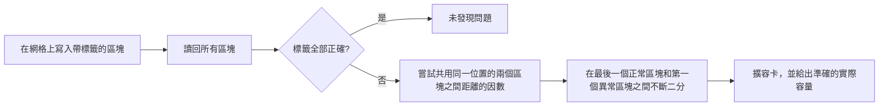
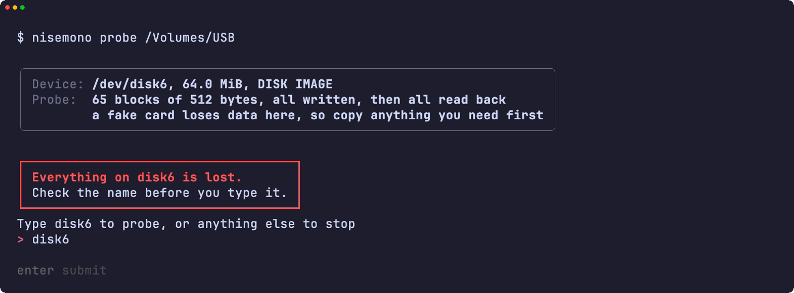
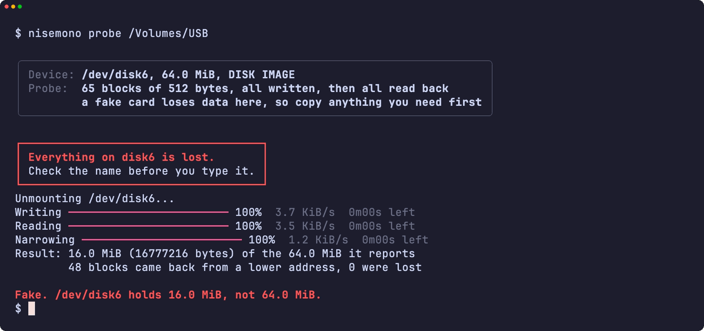
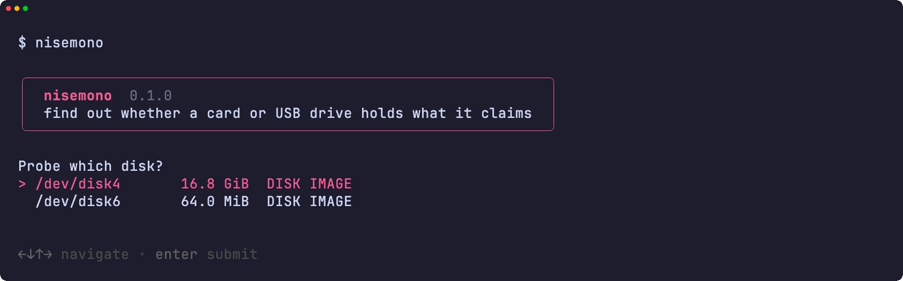
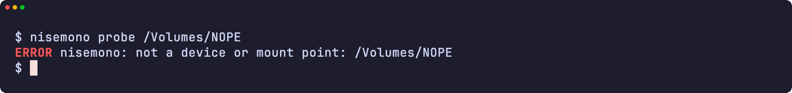
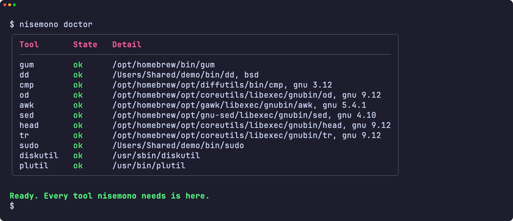
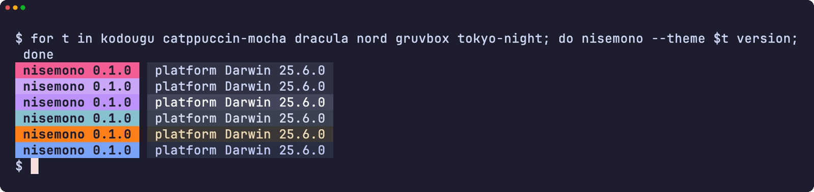
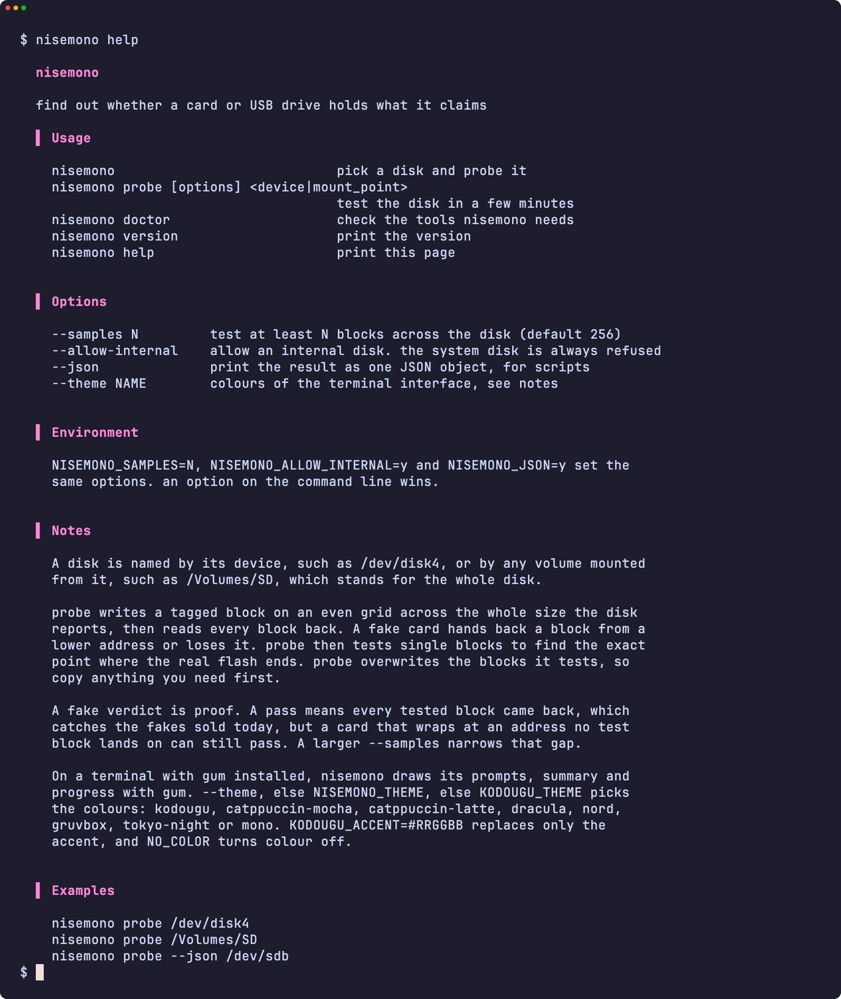
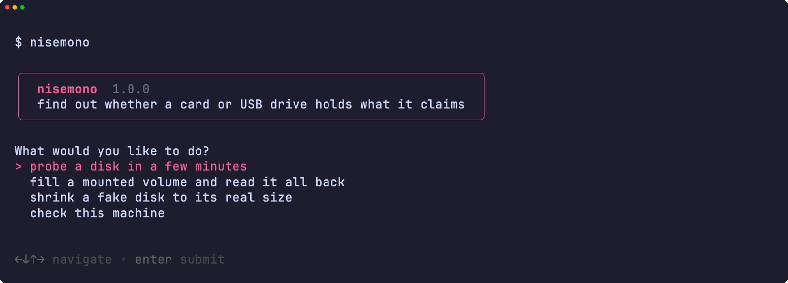

<div align="center">

<h1>nisemono</h1>

<strong>查明 SD 卡或 USB 手指是否真有標示的容量，以及它實際能儲存多少。</strong>

[English](README.md) | [日本語](README.ja.md) | [简体中文](README.zh-Hans.md) | 繁體中文 (香港)

[](https://github.com/gufranco/nisemono/actions/workflows/ci.yml)
[](https://github.com/gufranco/nisemono/releases/latest)
[](LICENSE)

<p align="center">
  <a href="#quick-start"><strong>快速開始</strong></a> |
  <a href="#how-it-works">運作原理</a> |
  <a href="#development">開發</a>
</p>

</div>

翻新擴容卡報告的容量比實際快閃記憶體大。超出實際容量寫入的檔案會覆蓋先前的資料或直接消失，直至開啟時才會發現。`nisemono` 是日文的「偽物」，意思是假貨。同系列的 [kiyome](https://github.com/gufranco/kiyome) 用來抹除磁碟，[kakikomi](https://github.com/gufranco/kakikomi) 用來寫入磁碟映像檔。

---

<p align="center">
  
</p>

```console
$ nisemono probe /dev/disk6

Device: /dev/disk6, 32.0 MiB, DISK IMAGE
Probe:  33 blocks of 512 bytes, all written, then all read back
        a fake card loses data here, so copy anything you need first

Type disk6 to probe, or anything else to stop: disk6
Unmounting /dev/disk6...
Writing 100%  7.8 KiB/s  0m00s left
Reading 100%  9.4 KiB/s  0m00s left
Narrowing 100%  2.3 KiB/s  0m00s left
Result: 9.5 MiB (9961472 bytes) of the 32.0 MiB it reports
        13 blocks came back from a lower address, 0 were lost
Fake. /dev/disk6 holds 9.5 MiB, not 32.0 MiB.
```

<a id="quick-start"></a>

## 快速開始

### 先決條件

| 工具 | 用途 | 安裝 |
|:-----|:----|:--------|
| [`gum`](https://github.com/charmbracelet/gum) | 終端介面：提示、表格和顏色 | `brew install gum`。Homebrew formula 會自動安裝 |
| POSIX `sh`、`dd`、`cmp`、`od`、`head`、`tr` | 工具本身 | macOS 和 Linux 已內置。毋須 `bash` |
| `diskutil` 和 `plutil`，或 `lsblk` 和 `blockdev` | 在 macOS 或 Linux 上讀取磁碟資料 | 已內置 |
| mtools 的 `mformat` | 只有 `fix` 建立新的 FAT 檔案系統時需要 | `brew install mtools` 或 `apt install mtools`。Homebrew formula 會自動安裝 |

### 安裝

```bash
brew install gufranco/tap/nisemono
```

或從原始碼安裝：

```bash
git clone https://github.com/gufranco/nisemono.git
cd nisemono
make install
```

`make install` 會把工具、man 手冊和 bash、zsh、fish 自動完成複製到 `~/.local` 之下，並把 `nisemono` 放到 `~/.local/bin`；可用 `PREFIX` 改變位置。

### 驗證

```console
$ nisemono doctor
gum                ok       /opt/homebrew/bin/gum
dd                 ok       /opt/homebrew/opt/coreutils/libexec/gnubin/dd, gnu 9.12
cmp                ok       /opt/homebrew/opt/diffutils/bin/cmp, gnu 3.12
od                 ok       /opt/homebrew/opt/coreutils/libexec/gnubin/od, gnu 9.12
awk                ok       /opt/homebrew/opt/gawk/libexec/gnubin/awk, gnu 5.4.1
sed                ok       /opt/homebrew/opt/gnu-sed/libexec/gnubin/sed, gnu 4.10
head               ok       /opt/homebrew/opt/coreutils/libexec/gnubin/head, gnu 9.12
tr                 ok       /opt/homebrew/opt/coreutils/libexec/gnubin/tr, gnu 9.12
sudo               ok       /usr/bin/sudo
diskutil           ok       /usr/sbin/diskutil
plutil             ok       /usr/bin/plutil
mformat            ok       /opt/homebrew/bin/mformat
```

## 用法

| 指令 | 用途 |
|:--------|:--------|
| `nisemono probe [options] <device\|mount_point>` | 數分鐘內測試磁碟並報告實際容量 |
| `nisemono fill <mount_point>` | 用校驗檔案填滿卷宗的剩餘空間，逐位元組讀回後刪除。速度較慢，但不會動你的檔案 |
| `nisemono fix <device\|mount_point>` | 測試磁碟，若是假貨，就在實際容量內建立一個 FAT 分割區。上面的內容會全部遺失 |
| 不帶參數的 `nisemono` | 在終端機中運行時，從選單選擇工作 |
| 不帶參數的 `nisemono` | 在終端中執行時，揀選一個磁碟並測試 |
| `nisemono doctor` | 列出 nisemono 需要的工具以及是否已安裝 |
| `nisemono version`、`nisemono help` | 顯示版本或完整用法 |

| 選項 | 效果 |
|:-------|:-------|
| `--samples N` | 在整個磁碟上最少測試 N 個區塊。預設 256 |
| `--allow-internal` | 容許內置磁碟。正在運行的系統所在的磁碟一律拒絕 |
| `--json` | 以一個 JSON 物件輸出結果，供指令碼使用 |
| `--theme <name>` | 終端介面的配色 |

亦可寫成 `--samples=1024`，`--` 表示選項完結。`NISEMONO_SAMPLES=N`、`NISEMONO_ALLOW_INTERNAL=y` 和 `NISEMONO_JSON=y` 設定相同的選項；指令列上的選項優先。

```bash
nisemono probe /dev/disk4                  # 測試 disk4 中的卡
nisemono probe /Volumes/SD                 # 已掛載的卷宗代表整個磁碟
nisemono probe --samples 4096 /dev/sdb     # 更密的網格，較慢
nisemono probe --json /dev/disk4           # 一個 JSON 物件，供指令碼使用
nisemono fill /Volumes/SD                  # 逐位元組檢查剩餘空間，保留你的檔案
nisemono fix /dev/disk4                    # 把假卡縮到它實際的容量
```

測試會覆蓋被測的區塊，在擴容卡上更會覆蓋更多資料，所以請先把需要的檔案複製出來。nisemono 依從同系列共用的指令列約定，見 [FAMILY.md](FAMILY.md)。

### 主題

在裝有 `gum` 的終端中，nisemono 以 gum 繪製提示、表格和訊息；在管道或指令碼中輸出保持純文字。配色依次由 `--theme`、`NISEMONO_THEME`、`KODOUGU_THEME` 決定：`kodougu`（預設）、`catppuccin-mocha`、`catppuccin-latte`、`dracula`、`nord`、`gruvbox`、`tokyo-night` 或 `mono`。`KODOUGU_ACCENT=#RRGGBB` 只替換強調色，`NO_COLOR` 關閉顏色。

<a id="how-it-works"></a>

## 運作原理

假控制器會回應快閃記憶體中並不存在的位址。超出實際快閃記憶體的寫入，要麼因控制器忽略高位位址而落到先前的位址上，要麼被丟棄。



1. 每個測試區塊都帶有本次執行的隨機碼和自身位址組成的標籤。所有區塊寫完之後才開始讀取，因為剛寫完即時讀取總是正確的，覆蓋只有在後面的區塊落到同一位置時才會出現。
2. 讀回同一標籤的區塊共用快閃記憶體中的同一位置。其中位址最低的是真實的，其餘都在實際快閃記憶體之外。沒有有效標籤的區塊已經遺失。
3. 判定為擴容卡之後，nisemono 從共用同一位置的兩個區塊之間距離的因數中找出回繞大小，再在最後一個正常區塊和第一個異常區塊之間不斷二分，直至只剩一個區塊。

擴容卡的判定是確實的證據。通過只代表所有測試區塊都已讀回，能找出現時市面上的擴容卡，但在測試區塊落不到的位址回繞的卡仍可能通過。加大 `--samples` 可以收窄這個空隙。

正在運行的系統所在的磁碟一律拒絕，內置磁碟除非指定 `--allow-internal` 否則拒絕，防寫的卡會被指出，已掛載的卷宗在寫入前會被卸載。

<a id="portability"></a>

## 可移植性

全部程式碼都是 POSIX `sh`，ShellCheck `-o all` 零警告。測試在 macOS 上的 `/bin/sh`、`dash`、系統內置的 bash 3.2 和 zsh、Homebrew 最新的 bash 和 zsh 下運行，亦在 Ubuntu 特權容器中的 `dash`、`bash`、`bash --posix` 和 `zsh` 下運行。它在 [FAMILY.md](FAMILY.md) 列出的六套工具集上都能運作，`nisemono doctor` 會顯示每個核心工具的種類和版本。

<a id="screens"></a>

## 畫面

<details>
<summary>以 <code>make screens</code> 從真實執行錄製的所有畫面</summary>
<br>

<table>
<tr>
<td width="50%" valign="top"><br><sub>危險提示框下輸入的名稱</sub></td>
<td width="50%" valign="top"><br><sub>對擴容卡的判定</sub></td>
</tr>
<tr>
<td width="50%" valign="top"><br><sub>磁碟揀選</sub></td>
<td width="50%" valign="top"><br><sub>錯誤</sub></td>
</tr>
<tr>
<td width="50%" valign="top"><br><sub>doctor 檢查所需的每個工具</sub></td>
<td width="50%" valign="top"><br><sub>六種主題下的版本標記</sub></td>
</tr>
<tr>
<td width="50%" valign="top"><br><sub>說明頁面</sub></td>
<td width="50%" valign="top"><br><sub>不帶參數的 nisemono 打開的選單</sub></td>
</tr>
</table>

</details>

<a id="development"></a>

## 開發

| 指令 | 說明 |
|:--------|:------------|
| `make fmt` | 以 shfmt 格式化所有指令碼 |
| `make lint` | shfmt、對所有指令碼、測試和自動完成執行 ShellCheck，以及以 mandoc 檢查 man 手冊 |
| `make test` | 在系統 `sh` 下執行 `bats` 測試 |
| `make test-all` | 在每種 shell 下執行同樣的測試 |
| `make test-linux` | 在 Ubuntu 容器中執行同樣的測試 |
| `make coverage` | 合併這部 Mac 和 Ubuntu 容器中的 bashcov 行覆蓋率，並執行 CI 同樣的 100% 門檻 |
| `make screens` | 在 macOS 上以 VHS 從真實工具錄製 README 畫面 |

測試以 `hdiutil` 或 `losetup` 掛接以檔案為後端的磁碟並真實地測試。擴容卡在 Linux 上由重複或丟棄部分磁碟的 device-mapper 表模擬，在 macOS 上由改寫或丟棄相同偏移的 `dd` 替身模擬。

## 授權

[MIT](LICENSE)
