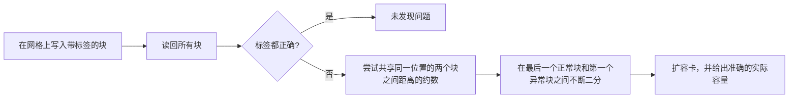
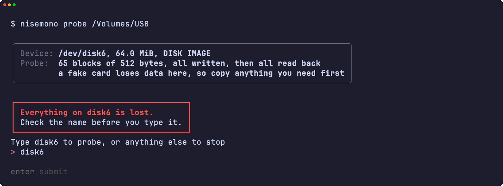
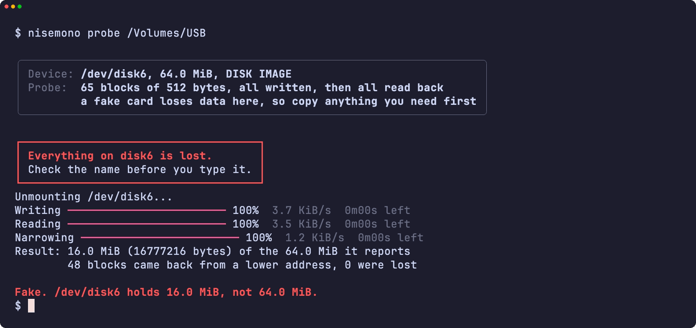
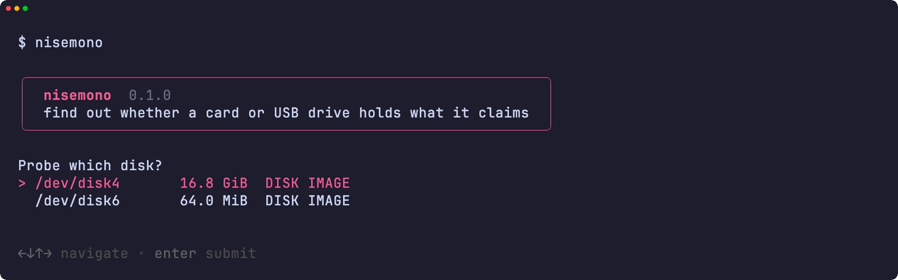
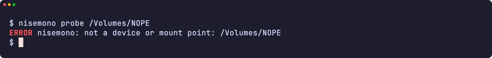
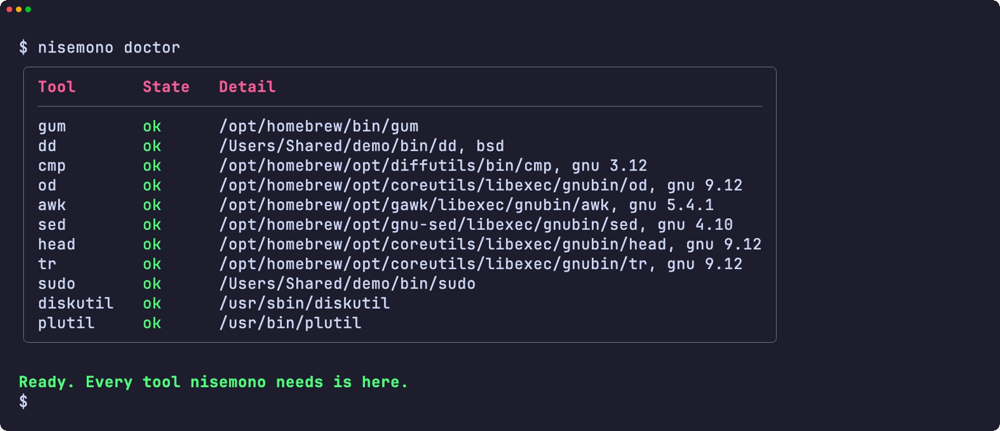
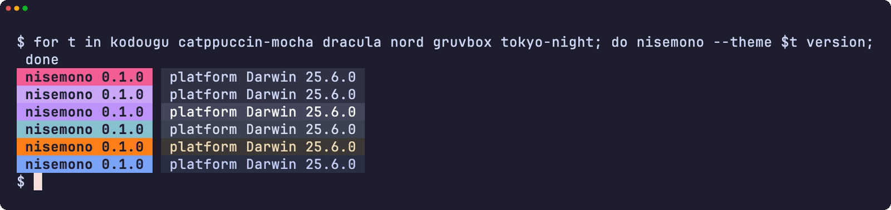
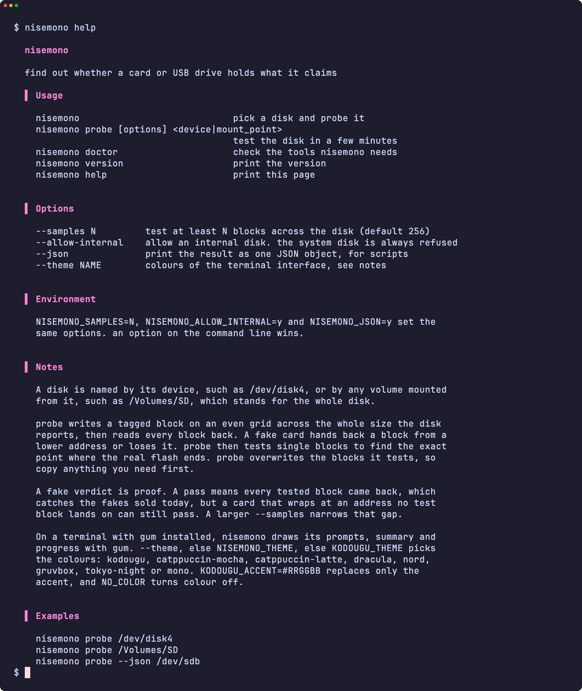
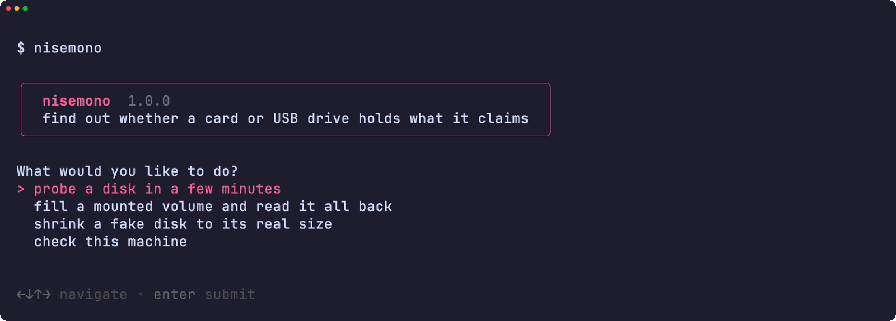

<div align="center">

<h1>nisemono</h1>

<strong>查明 SD 卡或 U 盘是否真有标称的容量，以及它实际能存多少。</strong>

[English](README.md) | [日本語](README.ja.md) | 简体中文 | [繁體中文 (香港)](README.zh-HK.md)

[](https://github.com/gufranco/nisemono/actions/workflows/ci.yml)
[](https://github.com/gufranco/nisemono/releases/latest)
[](LICENSE)

<p align="center">
  <a href="#quick-start"><strong>快速开始</strong></a> |
  <a href="#how-it-works">工作原理</a> |
  <a href="#development">开发</a>
</p>

</div>

扩容卡报告的容量比实际闪存大。超出实际容量写入的文件会覆盖之前的数据或直接消失，直到打开时才会发现。`nisemono` 是日语的「偽物」，意思是假货。同系列的 [kiyome](https://github.com/gufranco/kiyome) 用于擦除磁盘，[kakikomi](https://github.com/gufranco/kakikomi) 用于写入磁盘镜像。

---

<p align="center">
  
</p>

```console
$ nisemono probe /dev/disk6

Device: /dev/disk6, 32.0 MiB, DISK IMAGE
Probe:  33 blocks of 512 bytes, all written, then all read back
        a fake card loses data here, so copy anything you need first

Type disk6 to probe, or anything else to stop: disk6
Unmounting /dev/disk6...
Writing 100%  7.8 KiB/s  0m00s left
Reading 100%  9.4 KiB/s  0m00s left
Narrowing 100%  2.3 KiB/s  0m00s left
Result: 9.5 MiB (9961472 bytes) of the 32.0 MiB it reports
        13 blocks came back from a lower address, 0 were lost
Fake. /dev/disk6 holds 9.5 MiB, not 32.0 MiB.
```

<a id="quick-start"></a>

## 快速开始

### 前提条件

| 工具 | 用途 | 安装 |
|:-----|:----|:--------|
| [`gum`](https://github.com/charmbracelet/gum) | 终端界面：提示、表格和颜色 | `brew install gum`。Homebrew formula 会自动安装 |
| POSIX `sh`、`dd`、`cmp`、`od`、`head`、`tr` | 工具本身 | macOS 和 Linux 自带。不需要 `bash` |
| `diskutil` 和 `plutil`，或 `lsblk` 和 `blockdev` | 在 macOS 或 Linux 上读取磁盘信息 | 系统自带 |
| mtools 的 `mformat` | 仅 `fix` 创建新的 FAT 文件系统时需要 | `brew install mtools` 或 `apt install mtools`。Homebrew formula 会自动安装 |

### 安装

```bash
brew install gufranco/tap/nisemono
```

或从源码安装：

```bash
git clone https://github.com/gufranco/nisemono.git
cd nisemono
make install
```

`make install` 会把工具、man 手册和 bash、zsh、fish 补全复制到 `~/.local` 下，并把 `nisemono` 放到 `~/.local/bin`；用 `PREFIX` 可以改变位置。

### 验证

```console
$ nisemono doctor
gum                ok       /opt/homebrew/bin/gum
dd                 ok       /opt/homebrew/opt/coreutils/libexec/gnubin/dd, gnu 9.12
cmp                ok       /opt/homebrew/opt/diffutils/bin/cmp, gnu 3.12
od                 ok       /opt/homebrew/opt/coreutils/libexec/gnubin/od, gnu 9.12
awk                ok       /opt/homebrew/opt/gawk/libexec/gnubin/awk, gnu 5.4.1
sed                ok       /opt/homebrew/opt/gnu-sed/libexec/gnubin/sed, gnu 4.10
head               ok       /opt/homebrew/opt/coreutils/libexec/gnubin/head, gnu 9.12
tr                 ok       /opt/homebrew/opt/coreutils/libexec/gnubin/tr, gnu 9.12
sudo               ok       /usr/bin/sudo
diskutil           ok       /usr/sbin/diskutil
plutil             ok       /usr/bin/plutil
mformat            ok       /opt/homebrew/bin/mformat
```

## 用法

| 命令 | 用途 |
|:--------|:--------|
| `nisemono probe [options] <device\|mount_point>` | 几分钟内测试磁盘并报告实际容量 |
| `nisemono fill <mount_point>` | 用校验文件填满卷的剩余空间，逐字节读回后删除。速度较慢，但不会动你的文件 |
| `nisemono fix <device\|mount_point>` | 测试磁盘，若是假货，就在实际容量内建立一个 FAT 分区。上面的内容会全部丢失 |
| 不带参数的 `nisemono` | 在终端中运行时，从菜单选择任务 |
| 不带参数的 `nisemono` | 在终端中运行时，选择一个磁盘并测试 |
| `nisemono doctor` | 列出 nisemono 需要的工具以及是否已安装 |
| `nisemono version`、`nisemono help` | 显示版本或完整用法 |

| 选项 | 效果 |
|:-------|:-------|
| `--samples N` | 在整个磁盘上至少测试 N 个块。默认 256 |
| `--allow-internal` | 允许内置磁盘。正在运行的系统所在的磁盘总是被拒绝 |
| `--json` | 以一个 JSON 对象输出结果，供脚本使用 |
| `--theme <name>` | 终端界面的配色 |

也可以写成 `--samples=1024`，`--` 表示选项结束。`NISEMONO_SAMPLES=N`、`NISEMONO_ALLOW_INTERNAL=y` 和 `NISEMONO_JSON=y` 设置相同的选项；命令行上的选项优先。

```bash
nisemono probe /dev/disk4                  # 测试 disk4 中的卡
nisemono probe /Volumes/SD                 # 已挂载的卷代表整个磁盘
nisemono probe --samples 4096 /dev/sdb     # 更密的网格，更慢
nisemono probe --json /dev/disk4           # 一个 JSON 对象，供脚本使用
nisemono fill /Volumes/SD                  # 逐字节检查剩余空间，保留你的文件
nisemono fix /dev/disk4                    # 把假卡缩到它实际的容量
```

测试会覆盖被测的块，在扩容卡上还会覆盖更多数据，所以请先把需要的文件复制出来。nisemono 遵循同系列共用的命令行约定，见 [FAMILY.md](FAMILY.md)。

### 主题

在装有 `gum` 的终端中，nisemono 用 gum 绘制提示、表格和消息；在管道或脚本中输出保持纯文本。配色依次由 `--theme`、`NISEMONO_THEME`、`KODOUGU_THEME` 决定：`kodougu`（默认）、`catppuccin-mocha`、`catppuccin-latte`、`dracula`、`nord`、`gruvbox`、`tokyo-night` 或 `mono`。`KODOUGU_ACCENT=#RRGGBB` 只替换强调色，`NO_COLOR` 关闭颜色。

<a id="how-it-works"></a>

## 工作原理

假控制器会回应闪存中并不存在的地址。超出实际闪存的写入，要么因为控制器忽略高位地址而落到之前的地址上，要么被丢弃。



1. 每个测试块都带有本次运行的随机码和自身地址组成的标签。所有块写完之后才开始读取，因为刚写完马上读总是正确的，覆盖只有在后面的块落到同一位置时才会出现。
2. 读回同一标签的块共享闪存中的同一位置。其中地址最低的是真实的，其余都在实际闪存之外。没有有效标签的块已经丢失。
3. 判定为扩容卡之后，nisemono 从共享同一位置的两个块之间距离的约数中找出回绕大小，再在最后一个正常块和第一个异常块之间不断二分，直到只剩一个块。

扩容卡的判定是确凿的证据。通过只表示所有测试块都已读回，能发现目前市面上的扩容卡，但在测试块落不到的地址回绕的卡仍可能通过。增大 `--samples` 可以缩小这个空隙。

正在运行的系统所在的磁盘总是被拒绝，内置磁盘除非指定 `--allow-internal` 否则被拒绝，写保护的卡会被指出，已挂载的卷在写入前会被卸载。

<a id="portability"></a>

## 可移植性

全部代码都是 POSIX `sh`，ShellCheck `-o all` 零警告。测试在 macOS 上的 `/bin/sh`、`dash`、系统自带的 bash 3.2 和 zsh、Homebrew 最新的 bash 和 zsh 下运行，也在 Ubuntu 特权容器中的 `dash`、`bash`、`bash --posix` 和 `zsh` 下运行。它在 [FAMILY.md](FAMILY.md) 列出的六套工具集上都能工作，`nisemono doctor` 会显示每个核心工具的种类和版本。

<a id="screens"></a>

## 界面

<details>
<summary>用 <code>make screens</code> 从真实运行录制的所有界面</summary>
<br>

<table>
<tr>
<td width="50%" valign="top"><br><sub>危险提示框下输入的名称</sub></td>
<td width="50%" valign="top"><br><sub>对扩容卡的判定</sub></td>
</tr>
<tr>
<td width="50%" valign="top"><br><sub>磁盘选择</sub></td>
<td width="50%" valign="top"><br><sub>错误</sub></td>
</tr>
<tr>
<td width="50%" valign="top"><br><sub>doctor 检查所需的每个工具</sub></td>
<td width="50%" valign="top"><br><sub>六种主题下的版本标记</sub></td>
</tr>
<tr>
<td width="50%" valign="top"><br><sub>帮助页面</sub></td>
<td width="50%" valign="top"><br><sub>不带参数的 nisemono 打开的菜单</sub></td>
</tr>
</table>

</details>

<a id="development"></a>

## 开发

| 命令 | 说明 |
|:--------|:------------|
| `make fmt` | 用 shfmt 格式化所有脚本 |
| `make lint` | shfmt、对所有脚本、测试和补全运行 ShellCheck，以及用 mandoc 检查 man 手册 |
| `make test` | 在系统 `sh` 下运行 `bats` 测试 |
| `make test-all` | 在每种 shell 下运行同样的测试 |
| `make test-linux` | 在 Ubuntu 容器中运行同样的测试 |
| `make coverage` | 合并这台 Mac 和 Ubuntu 容器中的 bashcov 行覆盖率，并执行 CI 同样的 100% 门槛 |
| `make screens` | 在 macOS 上用 VHS 从真实工具录制 README 界面 |

测试用 `hdiutil` 或 `losetup` 挂接以文件为后端的磁盘并真实地测试。扩容卡在 Linux 上由重复或丢弃部分磁盘的 device-mapper 表模拟，在 macOS 上由改写或丢弃相同偏移的 `dd` 替身模拟。

## 许可证

[MIT](LICENSE)
